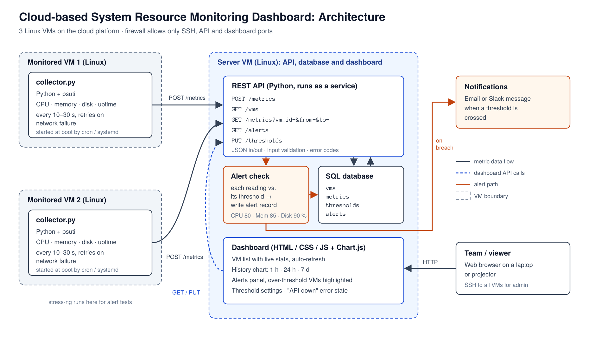

# Cloud-based System Resource Monitoring Dashboard

A cloud-based dashboard that monitors **CPU, memory, disk and uptime** across several Linux virtual machines. A Python collector on each VM sends a reading every 15 seconds to a central Flask REST API. The API stores readings in SQLite and checks each one against alert thresholds. A web dashboard shows current and historical usage, along with any warnings.

> **Draft status:** Items marked `TODO(owner)` need details from the person who owns that part. Please fill them in, or send them to JG in the group chat.

## Team

| Role | Owner | Area |
|---|---|---|
| Backend lead | Rene Acosta | Collector, REST API, SQL schema, alert logic, integration |
| Dashboard front end | Maha Aljaffan | HTML/CSS/JS, Chart.js history graphs, VM list, alerts panel |
| Cloud and VM engineer | Daniel Salaita | VMs, firewall, collector install (cron/systemd), server uptime |
| Alerts and testing | Fabian Salinas | Threshold config, email/Slack notifications, stress-ng tests, bug list |
| Docs and demo | JG Guerrero | README, architecture diagram, report, slides, demo script, backup video |

## Architecture



The project uses three Linux VMs:

- **Monitored VM 1 and VM 2.** Each runs `collector/collector.py`, which reads system stats with `psutil` and sends them to `POST /metrics` every 15 seconds. If the API can't be reached, it logs the error and tries again on the next cycle.
- **Server VM.** Hosts the Flask API on port 5000, the SQLite database (`api/monitor.db`) and the dashboard.
- **Alert flow.** Each incoming reading is compared with the thresholds. Any metric above its threshold gets an alert record, which the dashboard shows as a warning. Email or Slack notifications are planned (`TODO(Fabian)`).

The firewall opens only the ports needed for SSH, the API and the dashboard.

## Repository layout

```
.
├── api/
│   ├── app.py            # Flask REST API + alert check
│   └── schema.sql        # SQLite tables and default thresholds
├── collector/
│   └── collector.py      # runs on each monitored VM
├── dashboard/            # HTML/CSS/JS + Chart.js (TODO(Maha))
├── docs/                 # architecture diagram, demo script
└── requirements.txt
```

## Tech stack

| Layer | Tool |
|---|---|
| Metric collection | Python 3, `psutil`, `requests` |
| API | Python 3, Flask 3.1 |
| Database | SQLite |
| Dashboard | HTML, CSS, JavaScript, Chart.js |
| Scheduling | systemd |
| Notifications | Email or Slack. `TODO(Fabian)`: which one |
| Load testing | `stress-ng` |
| Hosting | 3 Linux VMs. `TODO(Daniel)`: cloud provider and Linux distro |

## Setup

### 1. Provision the VMs (Daniel)

1. Create three Linux VMs: `vm1` (monitored), `vm2` (monitored) and `server` (API + DB + dashboard).
2. Add each teammate's SSH key.
3. Firewall rules: allow **SSH (22)**, **API (5000)** and **dashboard (`TODO(Daniel)` port)**. Block everything else. Only the two monitored VMs and the team need to reach port 5000.

| VM | Role | IP / hostname |
|---|---|---|
| vm1 | Monitored | `TODO(Daniel)` |
| vm2 | Monitored | `TODO(Daniel)` |
| server | API, DB, dashboard | `TODO(Daniel)` |

### 2. Run the API on the server

```bash
ssh <user>@<server-ip>
git clone <repo-url> cloud-monitoring-dashboard
cd cloud-monitoring-dashboard
python3 -m venv venv && source venv/bin/activate
pip install -r requirements.txt

# quick test run: creates api/monitor.db from schema.sql, listens on 0.0.0.0:5000
python api/app.py
```

Check it from another terminal: `curl http://<server-ip>:5000/vms` should return `[]` before any collector has reported.

**Run it as a service so it comes back after a reboot.** Save this as `/etc/systemd/system/monitor-api.service`, replacing `<user>` and the path:

```ini
[Unit]
Description=Monitoring dashboard API
After=network-online.target

[Service]
User=<user>
WorkingDirectory=/home/<user>/cloud-monitoring-dashboard/api
ExecStart=/home/<user>/cloud-monitoring-dashboard/venv/bin/python app.py
Restart=always

[Install]
WantedBy=multi-user.target
```

```bash
sudo systemctl daemon-reload
sudo systemctl enable --now monitor-api
sudo systemctl status monitor-api
```

`TODO(Rene/Daniel)`: commit this unit file to the repo once it's tested.

### 3. Install the collector on each monitored VM

```bash
ssh <user>@<vm-ip>
git clone <repo-url> cloud-monitoring-dashboard
cd cloud-monitoring-dashboard
python3 -m venv venv && source venv/bin/activate
pip install psutil requests

# test run: should print "201 {...}" every 15 seconds
API_URL=http://<server-ip>:5000 VM_ID=vm1 python collector/collector.py
```

| Variable | Default | Meaning |
|---|---|---|
| `API_URL` | `http://localhost:5000` | Address of the API on the server VM |
| `VM_ID` | the VM's hostname | Name shown on the dashboard |
| `INTERVAL` | `15` | Seconds between readings |

**Start it at boot.** Save as `/etc/systemd/system/collector.service`, with `VM_ID` set to `vm1` or `vm2`:

```ini
[Unit]
Description=Monitoring collector
After=network-online.target

[Service]
User=<user>
Environment=API_URL=http://<server-ip>:5000
Environment=VM_ID=vm1
ExecStart=/home/<user>/cloud-monitoring-dashboard/venv/bin/python /home/<user>/cloud-monitoring-dashboard/collector/collector.py
Restart=always

[Install]
WantedBy=multi-user.target
```

```bash
sudo systemctl daemon-reload
sudo systemctl enable --now collector
journalctl -u collector -f     # watch it send readings
```

**Adding another VM (goal: about 15 minutes):** provision it, open SSH, repeat step 3 with a new `VM_ID`, and confirm it appears in `GET /vms`. `TODO(Daniel)`: link the full setup guide.

### 4. Open the dashboard (Maha)

`TODO(Maha)`: how the dashboard is served (Flask static route, nginx, or `python -m http.server`) and its URL. It calls the API at `http://<server-ip>:5000`. The API sends CORS headers, so the dashboard can be on a different port. The page refreshes automatically, and if the API is down it shows an error message instead of breaking.

## API reference

Base URL: `http://<server-ip>:5000`. All responses are JSON. Timestamps are ISO 8601 in UTC.

| Method | Path | Purpose |
|---|---|---|
| `POST` | `/metrics` | Collector submits one reading |
| `GET` | `/vms` | Latest reading for every VM |
| `GET` | `/metrics?vm_id=&from=&to=` | History for one VM |
| `GET` | `/alerts` | 100 most recent alerts |
| `GET` | `/thresholds` | Current thresholds |
| `PUT` | `/thresholds` | Change thresholds |

### `POST /metrics`

```json
{
  "vm_id": "vm1",
  "cpu": 42.5,
  "memory": 61.2,
  "disk": 73.0,
  "uptime": 86400,
  "timestamp": "2026-11-24T18:30:00+00:00"
}
```

`cpu`, `memory` and `disk` are percentages (disk = the `/` filesystem). `uptime` is seconds since boot. `timestamp` is optional; the server uses the current UTC time if it's missing.

The API stores the reading, updates the VM's `last_seen`, and checks each metric against its threshold.

- **201** `{"status": "ok", "alerts": ["cpu"]}`: `alerts` lists the metrics that crossed a threshold on this reading (empty list if none).
- **400** `{"error": "invalid payload"}`: a required field is missing or isn't a number.

### `GET /vms`

Latest reading for each VM that has reported:

```json
[{"id": 812, "vm_id": "vm1", "cpu": 12.0, "memory": 48.3, "disk": 61.0, "uptime": 90210, "ts": "2026-11-24T18:30:00+00:00"}]
```

### `GET /metrics?vm_id=&from=&to=`

History for one VM, **newest first, at most 1000 rows**. `vm_id` is required; `from` and `to` are optional ISO timestamps.

```
GET /metrics?vm_id=vm1&from=2026-11-24T17:30:00+00:00&to=2026-11-24T18:30:00+00:00
```

- **400** `{"error": "vm_id required"}`

### `GET /alerts`

The 100 most recent alerts, newest first:

```json
[{"id": 7, "vm_id": "vm1", "metric": "cpu", "value": 96.4, "threshold": 80.0, "ts": "2026-11-24T18:31:00+00:00"}]
```

### `GET /thresholds` and `PUT /thresholds`

Thresholds are **global** (the same for every VM). Defaults: **CPU 80%, memory 85%, disk 90%**.

```json
{ "cpu": 80, "memory": 85, "disk": 90 }
```

`PUT` accepts any of `cpu`, `memory`, `disk` (other keys are ignored) and returns the updated thresholds.

## Database

SQLite file `api/monitor.db`, created from `api/schema.sql` when the API starts. It is listed in `.gitignore`, so it isn't committed.

| Table | Columns |
|---|---|
| `vms` | `id` (VM name), `last_seen` |
| `metrics` | `id`, `vm_id`, `cpu`, `memory`, `disk`, `uptime`, `ts` (indexed on `vm_id, ts`) |
| `thresholds` | `metric` (`cpu` / `memory` / `disk`), `value` |
| `alerts` | `id`, `vm_id`, `metric`, `value`, `threshold`, `ts` |

Example queries (run with `sqlite3 api/monitor.db`):

```sql
-- latest 10 readings for vm1
SELECT ts, cpu, memory, disk FROM metrics WHERE vm_id = 'vm1' ORDER BY ts DESC LIMIT 10;
-- alert count per VM and metric
SELECT vm_id, metric, COUNT(*) FROM alerts GROUP BY vm_id, metric;
```

## Testing alerts

`stress-ng` pushes a monitored VM over its thresholds. With 15-second readings, the alert should show up on the dashboard within about a minute.

```bash
sudo apt install -y stress-ng
# CPU over 80%
stress-ng --cpu 0 --cpu-load 95 --timeout 120s
# memory over 85%
stress-ng --vm 2 --vm-bytes 90% --timeout 120s
# disk over 90%: TODO(Fabian), e.g. fallocate a large temp file, then delete it
```

Check the result with `curl http://<server-ip>:5000/alerts`. Note that an alert is written for **every** reading above the threshold, so a 2-minute stress test creates about 8 alerts per metric.

Each scenario is recorded in the test log with its expected and actual result. `TODO(Fabian)`: link the test log and bug list.

## Demo

See [`docs/DEMO_SCRIPT.md`](docs/DEMO_SCRIPT.md). The demo order is: normal monitoring, stress test, resulting alert, history chart. A recorded backup video is in `TODO(JG)`.

## Timeline

| Dates | Milestone |
|---|---|
| Nov 10–13 | Roles confirmed, repo created, API spec shared, 3 VMs provisioned |
| Nov 14–17 | Collector running on VMs, `POST /metrics` and database working, dashboard mock UI with fake data, test plan drafted |
| Nov 18–24 | GET endpoints done, dashboard wired to API with history charts, threshold alerts recorded, report draft |
| Nov 25–27 | Alert notifications, stress-ng alert demo working, bug fixes |
| Nov 28–Dec 1 | Final testing, README and diagram, demo rehearsal, backup demo video, submit |
